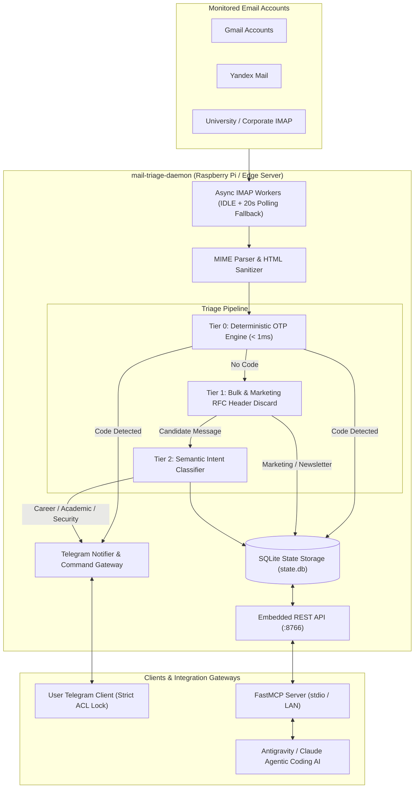

# Mail Triage & Verification Aggregation Daemon

Autonomous, privacy-first multi-account email triage service and Model Context Protocol (MCP) gateway designed for edge devices (Raspberry Pi, Linux home servers) and autonomous AI agent workflows (Google Antigravity, Claude Desktop, Cursor).

---

## Architecture Overview



---

## Core Capabilities

- **Sub-Millisecond Deterministic OTP Extraction**: Zero LLM inference latency (< 1ms execution time). Regex engine identifies Russian and English 2FA codes, account confirmation tokens, and Steam Guard keys while strictly eliminating false positives such as calendar years and phone numbers.
- **IMAP IDLE Event Driven**: Subscribes to unsolicited server pushes over persistent TLS connections, falling back to gentle 20-second poll cycles to ensure reliable message delivery even with non-standard IMAP implementations.
- **Strict Single-User Telegram Gateway**: All notifications and interactive bot controls are cryptographically locked to a single authorized user ID (`allowed_user_id`). Unauthorized interactions from external users are silently dropped without response.
- **Embedded REST API**: Exposes lightweight local endpoints (`:8766`) for health checks, unread statistics, remote IMAP search, and authenticated SMTP dispatch.
- **Model Context Protocol (MCP) Native**: Equips autonomous AI developer agents with tools to retrieve verification codes, search inboxes during automated logins, and inspect recent email traffic without cloud dependencies.
- **Resilient Edge Deployment**: Minimal RAM footprint (< 45 MB RSS), optimized for continuous 24/7 background operation via `systemd` on Raspberry Pi 4B/5 or Linux home servers.

---

## Telegram Bot Interface

The dedicated bot acts as an edge notifications dashboard and interactive control center.

| Command | Description |
|---|---|
| `/otp` | Display the most recent 2FA / OTP verification code with 1-tap copyable formatting |
| `/status` | Report daemon uptime, total processed messages, OTP extraction count, and mailbox states |
| `/recent` | List the most recently processed and triaged emails with category tags |
| `/search <query>` | Perform real-time IMAP search across all active inboxes (supports Cyrillic and UTF-8 queries) |
| `/ping` | Healthcheck response verification (`pong`) |
| `/help` | Detailed command reference and system documentation |

---

## Model Context Protocol (MCP) Server

The daemon includes an MCP server implementation (`mcp_server.py`) powered by FastMCP.

### Available Tools

1. `mail_get_latest_otp(service_name: str = "")`:
   Fetches the most recent verification code received within the last 15 minutes. Ideal for autonomous browser automation and registration workflows.
2. `mail_search_messages(query: str, account_id: str = "", limit: int = 5)`:
   Performs live IMAP search across configured mailboxes matching keywords, subject, or sender.
3. `mail_send_message(to: str, subject: str, body: str, account_id: str = "")`:
   Sends an email message via authenticated SMTP using the configured accounts.
4. `mail_list_recent(limit: int = 10, category: str = "")`:
   Returns recently processed triage events directly from local SQLite cache without network latency.
5. `mail_get_system_status()`:
   Queries daemon uptime, memory health, and active IMAP listener connections.

### Antigravity / Claude Desktop Configuration

Add the server to your `mcp_config.json`:

```json
{
  "mcpServers": {
    "mail-triage": {
      "command": "python",
      "args": [
        "/path/to/mail-triage-daemon/mcp_server.py"
      ],
      "env": {
        "MAIL_DAEMON_URL": "http://192.168.0.114:8766"
      }
    }
  }
}
```

---

## Installation & Setup

### Prerequisites

- Python 3.10+
- Linux environment (Debian, Ubuntu, Raspberry Pi OS, Arch)
- Dedicated Telegram Bot token (from `@BotFather`)

### 1. Clone & Dependencies

```bash
git clone https://github.com/ijstt/mail-triage-daemon.git
cd mail-triage-daemon
python3 -m venv venv
source venv/bin/activate
pip install -r requirements.txt
```

### 2. Configuration

Copy the example configuration and populate your mailbox credentials:

```bash
cp config/accounts.example.json config/accounts.json
chmod 600 config/accounts.json
```

Edit `config/accounts.json`:

```json
{
  "api_port": 8766,
  "db_path": "storage/state.db",
  "telegram": {
    "bot_token": "YOUR_TELEGRAM_BOT_TOKEN",
    "allowed_user_id": 123456789,
    "topic_otp": null,
    "topic_career": null,
    "topic_academic": null,
    "topic_digest": null
  },
  "accounts": [
    {
      "id": "gmail_primary",
      "email": "username@gmail.com",
      "password": "your_google_app_password",
      "host": "imap.gmail.com",
      "port": 993,
      "ssl": true,
      "enabled": true
    }
  ]
}
```

### 3. Running as a Systemd Service

To ensure continuous background operation on your edge host:

```bash
sudo cp systemd/mail-triage.service /etc/systemd/system/
sudo systemctl daemon-reload
sudo systemctl enable --now mail-triage.service
sudo systemctl status mail-triage.service
```

---

## Testing

Run the test suite covering deterministic OTP extraction, UTF-8 Cyrillic parsing, and classification tiers:

```bash
PYTHONPATH=. python tests/test_triage.py
```

---

## Security & Privacy Invariants

- **Zero Cloud Relay**: Email bodies and extracted credentials are processed strictly in-memory on the local host.
- **Encrypted Local Storage**: Only metadata (Message-ID, timestamp, category, subject) and short-lived OTP tokens are cached in SQLite.
- **Single Owner Isolation**: Hardcoded ACL enforcement prevents multi-user leakage in shared or public Telegram environments.

---

## License

MIT License. See `LICENSE` for details.
